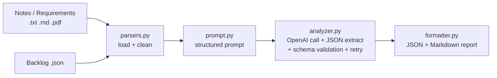

# Smart Backlog Assistant

Turns meeting notes, requirement docs (text/PDF) and an existing backlog (JSON) into structured user stories with acceptance criteria, priority and category, and flags duplicates / suggests groupings in existing backlogs. Uses OpenAI via the OpenAI Python SDK. See [SPEC.md](SPEC.md) for the original design.

## Problem and use cases

Teams collect ideas in notes, PDFs and informal backlog updates; converting them to a consistent backlog is manual. This tool drafts that backlog for human review.

1. **Meeting notes -> backlog**: user stories, acceptance criteria, open questions.
2. **Requirements doc analysis**: summary with priorities (explicit P0/P1... respected) and categories.
3. **Backlog cleanup**: duplicates, groupings, priority suggestions for existing items.

## Architecture



| File | Role |
|---|---|
| `app.py` | CLI, logging, error reporting (exit code 1 on user-facing errors) |
| `backlog_assistant/parsers.py` | Text/PDF/JSON loading, whitespace cleanup, input validation |
| `backlog_assistant/prompt.py` | System prompt and input assembly |
| `backlog_assistant/analyzer.py` | API call, JSON extraction, schema validation, self-correcting retries |
| `backlog_assistant/formatter.py` | Markdown report sorted by priority |

## Setup

```bash
python -m venv .venv
source .venv/bin/activate        # Windows: .venv\Scripts\activate
pip install -r requirements.txt
cp .env.example .env             # then put your OPEN_API_KEY in .env
```

PowerShell alternative to `.env`: `$env:OPEN_API_KEY="your_api_key_here"`.
The model defaults to `gpt-4o`; override with `--model` or `BACKLOG_MODEL` (e.g. `gpt-4o-mini` for lower cost). The key is read from `OPEN_API_KEY` (not the SDK default `OPENAI_API_KEY`).

## Usage

```bash
python app.py --notes samples/sample_meeting_notes.txt --backlog samples/backlog.json
python app.py --notes samples/requirements_doc.txt --out out.json --markdown report.md
python app.py --backlog samples/backlog.json          # backlog cleanup only
```

Output JSON follows the spec (`summary`, `user_stories[]` with `title`, `description`, `acceptance_criteria`, `priority`, `category`) plus reviewability extras: per-story `rationale`, `source`, `related_backlog_ids`, and top-level `backlog_review` (duplicates, groups, priority suggestions) and `open_questions`. If a story contains a number that isn't in the input, a top-level `warnings` list is added (see "Invented-detail check" below).

## Prompt design notes

The prompt (`backlog_assistant/prompt.py`) follows the spec's structure:

- **Role + objective** up front so the model knows the job.
- **Explicit JSON schema** with field-level hints, so output is machine-checkable; the code validates it rather than trusting it.
- **Constraints** targeting known failure modes: no speculative requirements, preserve technical context, vague items go to `open_questions` instead of becoming invented stories.
- **Rationale field** forces each priority/category to cite the source, which makes output reviewable against the notes.
- **Good vs poor example** shows the expected story format and measurable criteria.
- **Data delimiting** (`<notes>`, `<backlog>`) plus "data, not instructions" guards against prompt injection from document contents.
- **Duplicate handling**: existing backlog items are flagged rather than re-created as stories.

### Invented-detail check

Prompting alone did not stop the model adding specifics (e.g. "30 days", "at least 7 days"), so `analyzer.py` also checks the output in code. `check_unsupported_numbers` collects the numbers in each story's title, description and acceptance criteria, normalises them (`50k` and `50,000` both become `50000`), and compares them with the numbers in the notes and backlog. Unmatched numbers are logged as a warning, added to the result as `warnings`, and shown in the Markdown report under "Warnings (possible invented details)". It only warns (no retry), so it adds no API cost. It does not catch invented non-numeric details (roles, features) or numbers written as words.

Prompt iteration log (record real findings here as you run the samples):

| # | Change | Reason |
|---|---|---|
| 1 | Baseline: schema + constraints | Initial design from SPEC |
| 2 | Added `rationale`, `open_questions` | Make speculation visible and reviewable |
| 3 | Added overlap rule for backlog items | Avoid duplicate stories for items already tracked |
| 4 | First live run (gpt-4o): forbade invented numbers/roles in acceptance criteria, replaced the "30 days" example with a neutral one, required comparing every backlog pair, fixed `source` semantics, banned notes ideas under `backlog_review` | Run 1 invented "30 days", "immediately", "current exchange rate"; missed BL-103/BL-104; filed "dark mode" as an existing backlog item |
| 5 | Added the code-level number check (not a prompt change) | Run 2 still produced "at least 7 days" despite the prompt rule; prompts reduce but do not eliminate invention |

## Error handling

Missing/empty/unreadable files, invalid backlog JSON, PDFs with no text, and untitled backlog entries are reported cleanly. A missing `OPEN_API_KEY` stops the run with a clear error. API connection/status errors give clear messages (SDK retries 429/5xx with backoff). Malformed or schema-invalid model output is fed back to the model for correction, up to 3 attempts. Each pipeline step is logged to stderr (`-v` for debug).

## Testing approach

Automated, offline (fake client, no API cost): `pytest` covers empty/missing files, malformed backlog JSON, JSON extraction from fenced output, schema validation, retry-on-malformed, give-up behaviour, and the invented-number check.

Manual review against realistic inputs in `samples/`:

| Input | What to check |
|---|---|
| `sample_meeting_notes.txt` (vague ideas) | "Remember me" and SSO/Okta become stories (SSO High, Nov 30 deadline kept); notifications and dark mode are not over-specified; CSV timeout threshold is raised as an open question, not invented |
| `requirements_doc.txt` (formal, prioritized) | P0 > P1 > P2 > P3 mapped to High/Medium/Low; the 5s/200-line and PCI constraints are preserved; "Out of scope" items produce no stories |
| `backlog.json` (mixed + duplicates) | BL-101/BL-102 and BL-103/BL-104 flagged as duplicates; BL-107 (SAML SSO, Low) flagged as under-prioritised vs the Nov 30 deadline; BL-106 grouped as housekeeping |

### Live results (gpt-4o, 2026-10-27; outputs are non-deterministic)

| Check | Run 1 (prompt v3) | Run 2 (prompt v4) |
|---|---|---|
| Requirements doc: P0/P1/P2/P3 -> High/Medium/Low, 5s/200-line and PCI kept, out-of-scope ignored | Pass | Pass (acceptance criteria stay close to the source) |
| Meeting notes: SSO High with Nov 30 deadline; CSV limit raised as an open question | Pass | Partly: a story now says "more than 50,000 rows" although the note only says Marco *thinks* >50k |
| No invented details in acceptance criteria | Fail ("30 days", "immediately", "current exchange rate") | Mostly pass in single-input runs; the combined run still invented "at least 7 days" |
| Backlog duplicates (BL-101/102 and BL-103/104) | Found 1 of 2 | Found both, in the backlog-only and combined runs |
| Notes idea filed as an existing backlog item ("dark mode") | Fail | Fixed |
| BL-106 grouped | No | Yes |
| BL-107 raised for the Nov 30 deadline (needs notes + backlog) | Yes (combined) | Yes (combined) |

After run 2 the number check was added; it flags the "7 days" kind of invention automatically (covered by unit tests; a later live combined run produced no number warnings).

Remaining weaknesses: the model still occasionally adds specifics (e.g. "7 days"), priorities shift between runs (checkout tests: Medium, then High), and the combined run dropped the CSV timeout story because BL-103 already covers it. Reviewers should keep checking acceptance criteria against the source. Next ideas: lower temperature, a stronger model, and extending the check to non-numeric details.

## Reflection and next steps

Worked well: a validated schema plus self-correcting retries gives dependable structure, and the rationale/open-questions fields make review quick. Limitations: duplicate detection is LLM judgment (no embeddings), PDFs are text-only (no OCR/tables), very large backlogs are sent in one prompt, and priorities are suggestions only. Next: embedding-based dedup pre-pass, chunking for large inputs, richer schema (estimates, dependencies), Jira/GitHub integration, and an interactive approve/edit step.
