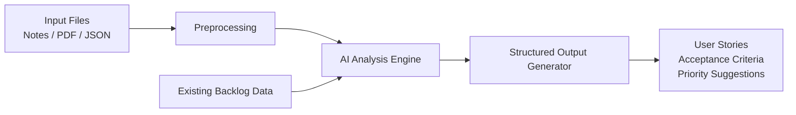

# Smart Backlog Assistant

A practical AI-powered engineering project that turns meeting notes, requirement documents, and backlog data into clean, actionable engineering work items.

## Overview

Engineering teams often lose time translating vague meeting notes, product discussions, and raw requirements into structured backlog items. This project demonstrates how AI can help turn fragmented inputs into organized user stories, task lists, acceptance criteria, and priorities.

The goal is to build a simple but real solution that:

- processes text or PDF inputs
- reviews an existing backlog or JSON list of tasks
- identifies key requirements and themes
- generates structured user stories and tasks
- suggests priority and categorization
- provides explainable, reviewable output

## Project Objective

Build a working AI-assisted tool that helps organize and structure engineering work by:

- processing meeting notes or requirement documents
- analyzing backlog items from JSON or similar structured data
- generating structured outputs such as user stories and task lists
- surfacing the most important requirements and priorities

## Problem Statement

Teams frequently collect ideas in unstructured formats: meeting recordings, notes, emails, PDFs, and informal backlog updates. These artifacts are often difficult to convert into a consistent backlog without manual effort and review.

This project addresses that gap by using AI to help convert noisy or incomplete inputs into a clearer and more actionable engineering plan.

## Use Cases

1. Meeting Notes to Backlog
   - Input: engineering meeting notes or sprint discussions
   - Output: user stories, tasks, and acceptance criteria

2. Requirements Document Analysis
   - Input: product requirements or spec notes in text or PDF form
   - Output: structured requirement summary with priorities and categories

3. Backlog Prioritization and Cleanup
   - Input: existing backlog JSON or task list
   - Output: prioritization suggestions, duplicates identified, and task grouping

## Solution Design

The application will combine lightweight data processing with AI-based summarization and transformation.



### Core Components

- Input parser: reads text, PDF, and JSON backlog inputs
- Preprocessing layer: cleans notes and extracts useful information
- AI reasoning layer: summarizes requirements and identifies patterns
- Output formatter: creates user stories, tasks, and priority recommendations
- Error handling: validates malformed inputs and handles API failures gracefully

### Prompt Design Approach

The AI prompt should be intentionally structured to produce consistent outputs. A good prompt includes:

- role and objective
- relevant context from the user input
- desired output format
- constraints and quality checks
- examples of clear vs poor output

Example prompt pattern:

```text
You are an engineering backlog assistant.
Your task is to analyze the provided meeting notes and backlog items.
Extract key requirements, identify clear user stories, and produce:
1. User story title
2. Description
3. Acceptance criteria
4. Suggested priority
5. Category or work stream

Requirements:
- Be concise and actionable
- Avoid speculative requirements not supported by the input
- Preserve important technical context
- Return valid structured JSON
```

## Features

- AI-assisted conversion of notes into backlog items
- Basic PDF/text ingestion support
- Analysis of existing backlog data in JSON format
- Structured user stories with description and acceptance criteria
- Suggested priority and work categorization
- Basic validation and error reporting
- Simple logging for visibility into processing steps

## Recommended Stack

This project is intentionally lightweight and can be implemented with a simple stack such as:

- Python for core logic
- OpenAI, Anthropic, or Hugging Face API for AI processing
- JSON for backlog data handling
- Optional PDF extraction libraries for document parsing
- CLI or small web interface for demonstration

## Project Goals

This solution should demonstrate:

- practical AI use in a common engineering workflow
- thoughtful prompt engineering
- readable, maintainable code
- usable output with real-world constraints
- clear documentation and testing

## Required Deliverables

The final solution should include:

1. Problem definition and use cases
2. Simple architecture diagram
3. Prompt design notes
4. Testing approach with realistic sample inputs
5. Working code demonstrating the core functionality
6. Clear setup instructions in this README
7. A brief reflection on the approach and improvements

## Implementation Expectations

The project should be scoped to be realistic and achievable in a focused effort. Recommended project size:

- 200-500 lines of code excluding dependencies
- implementable in 8-12 hours of focused work
- simple but reliable architecture
- enough functionality to demonstrate the AI workflow end to end

## Testing Approach

The solution should be validated with several realistic scenarios.

### Example Test Inputs

- a short meeting summary with vague feature ideas
- a more formal requirements doc with multiple prioritized items
- a backlog file containing mixed tasks and duplicate work items

### What Good Output Looks Like

A strong result should include:

- clear and useful user story titles
- complete descriptions without vague language
- realistic acceptance criteria
- logical categorization
- clear priority suggestions
- only requirements supported by source material

### Validation Method

- manually review generated output against source notes
- check that the result is clear, structured, and actionable
- verify that edge cases and malformed inputs are handled gracefully

## Setup Instructions

1. Clone the repository
2. Create a virtual environment
3. Install dependencies
4. Add your AI API key to an environment file
5. Run the application with sample inputs

Example:

```bash
git clone <repository-url>
cd fde-cert
python -m venv .venv
source .venv/bin/activate  # Windows: .venv\Scripts\activate
pip install -r requirements.txt
```

Then configure environment variables, for example:

```bash
export OPENAI_API_KEY="your_api_key_here"
```

On Windows PowerShell:

```powershell
$env:OPENAI_API_KEY="your_api_key_here"
```

## Example Usage

A typical workflow might look like this:

```bash
python app.py --notes sample_meeting_notes.txt --backlog backlog.json
```

Expected output could include:

- user stories
- acceptance criteria
- requirement summary
- suggested priority
- task breakdown

## Example Output Format

```json
{
  "summary": "Key requirements identified from meeting notes and backlog",
  "user_stories": [
    {
      "title": "As a team lead, I want a prioritized backlog so that I can manage work efficiently",
      "description": "The system should summarize work items and identify priorities based on notes and currently tracked tasks.",
      "acceptance_criteria": [
        "The tool extracts the main requirements from notes and documents.",
        "The tool groups related tasks into coherent backlog items.",
        "The tool suggests a priority level for each item."
      ],
      "priority": "High",
      "category": "Planning"
    }
  ]
}
```

## Error Handling

The implementation should include basic defensive programming, such as:

- invalid or empty input handling
- missing API key warnings
- failed AI request retries or graceful fallback messages
- validation for malformed JSON or unreadable files
- clear user-facing error output

## Documentation Requirements

The project should include a brief narrative covering:

- the problem being solved
- the data and AI workflow used
- examples of prompts and why they were structured that way
- key testing results and findings
- what worked well and what would be improved next

## Reflection and Improvement Ideas

This project is meant to demonstrate thoughtful use of AI rather than build a fully production-ready product. Good follow-up improvements could include:

- support for more document types
- improved output validation
- richer schema definitions
- integration with a real backlog system
- better ranking and deduplication logic
- human-in-the-loop review workflow

## Evaluation Criteria

A successful submission should demonstrate that:

- the solution works and solves the stated problem
- the code is readable and reasonably well structured
- AI is used meaningfully and effectively
- the prompts are thoughtful and purposeful
- the solution can be run and reviewed by others

## Scope Guidance

Focus on building a simple, well-executed demonstration rather than a large or overly complex system. The best outcomes will come from:

- starting simple
- validating each stage of the workflow
- documenting AI usage and prompt iterations
- testing with realistic examples
- showing clear thinking and engineering judgment

## Conclusion

This project demonstrates a practical AI engineering workflow: transforming rough, unstructured information into a usable, reviewable backlog. It is an ideal sample for showing AI-assisted problem solving, prompt design, and end-to-end software implementation in a realistic engineering context.

---

This repository is intended to serve as a project starter and documentation foundation for the Smart Backlog Assistant concept.